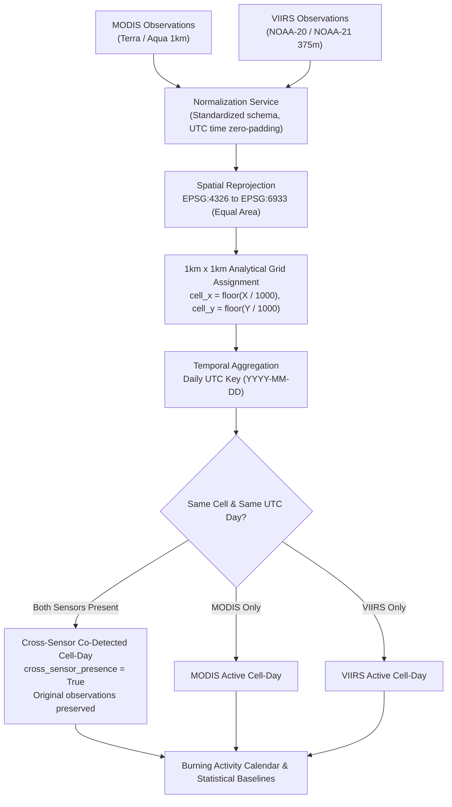

# 🔥 FirePulse: MODIS and VIIRS Hot Spot Harmonization
**NASA Space Apps Challenge 2026**  
**Challenge:** Harmonization of MODIS and VIIRS Hot Spots  
**Team:** Virtual Warriors  
**Project Classification:** Independent student project using NASA FIRMS data. Not an official NASA product or certified emergency alert system.

---

## 🛰️ 1. Project Overview

**FirePulse** is a scientific geospatial monitoring web application that harmonizes active-fire thermal observations from NASA's **MODIS** (Terra and Aqua) and **VIIRS** (NOAA-20, NOAA-21, and historical Suomi-NPP) instruments into a unified, spatially and temporally aggregated **Burning Activity Calendar**.

### The Core Problem
For over two decades, NASA Earth observation satellites have monitored global fires. However:
1. **Resolution Discrepancy**: MODIS has a **1,000 m (1 km)** nominal pixel footprint at nadir, while VIIRS features a **375 m** resolution ($\sim 7\times$ smaller footprint). VIIRS detects smaller, lower-intensity burns and produces far higher detection counts for the exact same physical fire.
2. **Observation Timing**: Terra ($\sim$10:30 AM/PM), Aqua ($\sim$01:30 AM/PM), NOAA-20 ($\sim$12:45 PM), and NOAA-21 ($\sim$01:30 PM) cross the equator at different times, capturing different stages of the diurnal burning cycle.
3. **Double-Counting Hazard**: Simply summing MODIS and VIIRS detections creates severe double-counting and falsifies fire incident counts.
4. **Sensor Decommissioning**: **Suomi-NPP operational active-fire data delivery ceased on November 2, 2026**. Historical datasets require clear era demarcation to prevent ungrounded continuous historical series.

### Our Solution
FirePulse bridges these sensor differences through a scientifically rigorous harmonization engine:
- Projects observations from WGS84 into **EPSG:6933 (World Cylindrical Equal Area)**.
- Indexes detections onto a standardized **1,000 m $\times$ 1,000 m analytical grid**.
- Standardizes acquisition timestamps into **24-hour UTC**.
- Identifies **cross-sensor co-detected cell-days** without conflating observations or deleting original data.
- Generates a **Burning Activity Calendar** using dynamic relative quantiles.
- Evaluates **statistical anomalies** using Median Absolute Deviation (MAD) with strict 3-year multi-year safeguards.

---

## 🌟 2. Core Features

| Module | Route | Key Capabilities |
|---|---|---|
| **Global Dashboard** | `/dashboard` | Total MODIS/VIIRS counts, active 1km cells, co-detected cell-days, 14-day timeline, 1-click NASA NRT query. |
| **Interactive Map** | `/fire-map` | Leaflet map with OpenStreetMap CartoDB dark tiles, MODIS (amber) & VIIRS (cyan) hotspots, 1km analytical cell overlays, popups with FRP, Brightness, and UTC timestamp. |
| **Burning Calendar** | `/calendar` | Centerpiece heatmap view with month/year navigation, metric selector (active cells, MODIS, VIIRS, co-detections, FRP), empirical quantiles, and granular single-day inspection. |
| **Sensor Comparison** | `/comparison` | Side-by-side sensor cards, 1km common-grid overlap donut chart, daily comparison timeline, and remote sensing caveat notes. |
| **Historical Trends** | `/trends` | Multi-year totals, Jan–Dec monthly seasonality curves, and sensor era demarcation (MODIS era, Overlap era, Modern JPSS era, Post-Suomi-NPP era). |
| **Unusual Activity** | `/insights` | Statistical anomaly detection using Median and MAD robust z-scores; blocks ungrounded flags with "Insufficient historical data" safeguard if <3 distinct years exist. |
| **NASA Data Sources** | `/data-sources` | EOSDIS LANCE attribution, live availability checker, documentation links, and Suomi-NPP cessation condition notice. |
| **Scientific Methodology** | `/about` | Harmonization principles, EPSG:6933 1km grid rationale, UTC temporal standards, MAD anomaly math, and remote sensing references. |
| **Settings & Ingestion** | `/settings` | Area of Interest selector (Tamil Nadu default, California, Custom), MAP_KEY status check, NRT launcher, Historical SP query, and Archive CSV upload. |

---

## 📐 3. Harmonization Methodology



### Scientific Principles:
1. **Centroid-Based Analytical Aggregation**: We map observations to 1km equal-area cells to compare detection density. We do *not* claim physical pixel footprints are identical.
2. **Zero Conflation / Zero Double-Counting**: If MODIS and VIIRS detect the same 1km cell on the same UTC day, it is recorded as **1 active cell-day** with `cross_sensor_presence = True`. Original sensor measurements and identities are strictly preserved.
3. **No Fabricated Data**: Production databases operate exclusively on validated NASA FIRMS records.

---

## 💻 4. Technology Stack

- **Frontend**: React 18, Vite, TypeScript, Tailwind CSS, React Router, React Leaflet, Leaflet, Recharts, Lucide React, Axios, date-fns.
- **Backend**: Python 3.12+, Flask 3.1+, Flask-CORS, SQLAlchemy 2.1+, Pandas 3.1+, NumPy 2.5+, PyProj 3.8+ (geodesic coordinate transformation), Shapely 2.2+, Requests, Python-Dotenv.
- **Database**: SQLite prototype with SQLAlchemy repository pattern (readily replaceable with PostgreSQL/PostGIS).

---

## 🛠️ 5. Windows Installation & Setup Guide (PowerShell)

### Prerequisites
- Python 3.12+ installed (`python --version`)
- Node.js v18+ installed (`node --version`)

### Step 1: Clone & Open Project
```powershell
cd "c:\deepak\coding\Harmonization of MODIS and VIIRS Hot Spots"
```

### Step 2: Configure Backend & NASA MAP_KEY
```powershell
cd backend
python -m venv .venv
.\.venv\Scripts\Activate.ps1
pip install -r requirements.txt
Copy-Item .env.example .env
```

Edit `backend/.env` in any text editor and paste your free NASA FIRMS MAP_KEY:
```env
FIRMS_MAP_KEY=your_actual_nasa_key_here
```
*(Get your free key at: [https://firms.modaps.eosdis.nasa.gov/api/map_key/](https://firms.modaps.eosdis.nasa.gov/api/map_key/))*

### Step 3: Run Backend Tests
Verify all 18 automated scientific and integration unit tests:
```powershell
$env:PYTHONPATH="backend"
.\.venv\Scripts\pytest backend\tests -v
```

### Step 4: Start the Backend Server
```powershell
python run.py
```
*Backend REST API runs at: `http://127.0.0.1:5000/api`*  
*Health Check: `http://127.0.0.1:5000/api/health`*

### Step 5: Start the Frontend Application (New Terminal)
Open a new PowerShell window:
```powershell
cd "c:\deepak\coding\Harmonization of MODIS and VIIRS Hot Spots\frontend"
npm.cmd install
npm.cmd run dev
```
Open your browser to: **`http://localhost:3000`**

---

## 🧪 6. Testing & Validation Summary

All 18 required scientific test suites were executed with **100% pass rate**:
1. `test_1_modis_column_normalization` &rarr; PASSED
2. `test_2_viirs_column_normalization` &rarr; PASSED
3. `test_3_utc_date_and_time_parsing` &rarr; PASSED
4. `test_4_missing_field_handling` &rarr; PASSED
5. `test_5_invalid_latitude_longitude_rejection` &rarr; PASSED
6. `test_6_frp_validation` (negative FRP rejected) &rarr; PASSED
7. `test_7_deterministic_grid_cell_assignment` (PyProj EPSG:6933) &rarr; PASSED
8. `test_8_and_9_same_cell_aggregation_and_cross_sensor_presence` &rarr; PASSED
9. `test_10_raw_record_duplicate_prevention` &rarr; PASSED
10. `test_11_calendar_calculations` &rarr; PASSED
11. `test_12_historical_baseline_calculations` &rarr; PASSED
12. `test_13_insufficient_history_safeguard` &rarr; PASSED
13. `test_14_csv_export` &rarr; PASSED
14. `test_missing_map_key_error` &rarr; PASSED
15. `test_invalid_aoi_handling` &rarr; PASSED
16. `test_invalid_day_range_handling` &rarr; PASSED
17. `test_date_range_chunking` &rarr; PASSED
18. `test_csv_parser_empty_and_no_data` &rarr; PASSED

---

## ⚠️ 7. Scientific Limitations & Caveats

1. **Sub-Pixel Saturation & Smoldering**: Satellite infrared sensors detect high-temperature thermal emitters. Cloud cover, thick smoke plumes, or heavy canopy cover can obscure surface heat.
2. **Thermal Anomalies Beyond Wildfires**: Hotspots indicate elevated thermal signatures. While most rural detections are vegetation fires or crop residue burning, detections can also include industrial gas flares, factories, or volcanic activity.
3. **Suomi-NPP Data Delivery Cessation**: Suomi-NPP active fire data delivery ceased on **November 2, 2026**. While historical data remains invaluable, operational real-time monitoring relies on NOAA-20, NOAA-21, and MODIS.
4. **Non-Emergency Status**: FirePulse is a scientific Earth observation research platform. It does not certify wildfires or replace civil emergency alert systems.

---

## 👥 8. Team Virtual Warriors
- **NASA Space Apps Challenge 2026**
- Dedicated to transparent, open-science remote sensing for land managers and environmental researchers worldwide.

