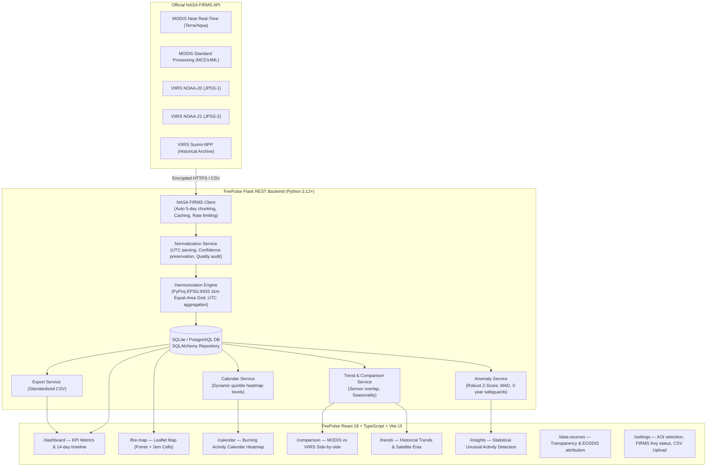

# FirePulse — System Architecture
**NASA Space Apps Challenge 2026 | Challenge: Harmonization of MODIS and VIIRS Hot Spots**  
**Team: Virtual Warriors**

---

## 1. High-Level Architecture Overview

FirePulse is an end-to-end scientific web application designed for environmental researchers, land managers, and Earth observation scientists. It transforms heterogeneous satellite active-fire detections from NASA FIRMS into a harmonized, spatially and temporally aggregated analytical intelligence platform.

---

## 2. Component Design

### 2.1 Backend Architecture
- **Framework**: Python 3.12+ with Flask and Flask-CORS.
- **REST Endpoints**:
  - `GET /api/health`: System health and MAP_KEY status (without secret exposure).
  - `GET /api/data/sources`: Supported sensor catalog and Nov 2, 2026 Suomi-NPP condition notice.
  - `GET /api/data/availability`: NASA FIRMS availability checker.
  - `POST /api/data/ingest/recent`: Near Real-Time (NRT) automated ingestion.
  - `POST /api/data/ingest/historical`: Standard Processing (SP) ingestion with chunking.
  - `POST /api/data/import/archive`: Offline NASA FIRMS Archive CSV parser.
  - `GET /api/dashboard/summary`: Global KPIs and recent 14-day timeline.
  - `GET /api/hotspots`: Filtered point observations and active 1km cells for Leaflet mapping.
  - `GET /api/calendar`: Burning Activity Calendar heatmap with dynamic empirical thresholds.
  - `GET /api/calendar/day`: Single-day granular spatial breakdown.
  - `GET /api/comparison`: MODIS vs VIIRS statistical comparison and 1km cell overlap.
  - `GET /api/trends`: Multi-year totals, monthly seasonality curves, and sensor era tags.
  - `GET /api/anomalies`: Robust statistical anomaly detection with multi-year safeguards.
  - `GET /api/data-quality`: Ingestion batch audit reports.
  - `GET /api/export/csv`: Streaming CSV export for observations and harmonized grid cells.

### 2.2 Geospatial Harmonization Pipeline
- **Coordinate Transformation**: Coordinates in `EPSG:4326` (WGS84) are projected to `EPSG:6933` (World Cylindrical Equal Area) using PyProj.
- **Analytical Grid**: Fixed 1,000 m $\times$ 1,000 m cells deterministically computed via:
  $$\text{cell}_x = \lfloor X / 1000 \rfloor, \quad \text{cell}_y = \lfloor Y / 1000 \rfloor$$
- **Cross-Sensor Presence**:
  $$\text{cross\_sensor\_presence} = (\text{MODIS\_count} > 0) \land (\text{VIIRS\_count} > 0)$$
  Observations in the same cell-day are labeled as cross-sensor co-detections without conflating them into a single fire count or deleting original observations.

### 2.3 Frontend Architecture
- **Framework**: React 18, Vite, TypeScript, Tailwind CSS.
- **State Management**: React Context (`AOIContext`) for seamless Area of Interest switching across all tabs.
- **Mapping Engine**: Leaflet with OpenStreetMap CartoDB dark tiles, rendering MODIS (amber) and VIIRS (cyan) hotspots, plus 1km analytical cell bounding boxes.
- **Charts & Visualization**: Recharts for Area, Line, Bar, and Donut charts.

---

## 3. Database Schema

### Table: `observations`
| Column | Type | Description |
|---|---|---|
| `id` | INTEGER PRIMARY KEY | Auto-increment primary key |
| `observation_id` | VARCHAR(64) UNIQUE | Deterministic unique observation ID |
| `source_record_hash` | VARCHAR(64) UNIQUE | SHA-256 hash for raw duplicate prevention |
| `sensor_family` | VARCHAR(16) | 'MODIS' or 'VIIRS' |
| `satellite` | VARCHAR(32) | 'Terra', 'Aqua', 'NOAA-20', 'NOAA-21', 'Suomi-NPP' |
| `instrument` | VARCHAR(16) | 'MODIS', 'VIIRS' |
| `source_id` | VARCHAR(32) | e.g. 'MODIS_NRT', 'VIIRS_NOAA20_NRT' |
| `processing_type` | VARCHAR(16) | 'NRT', 'SP', 'ARCHIVE' |
| `latitude` | FLOAT | Validated latitude [-90, 90] |
| `longitude` | FLOAT | Validated longitude [-180, 180] |
| `grid_cell_id` | VARCHAR(64) | 1km Equal-Area cell identifier |
| `proj_x` | FLOAT | Projected EPSG:6933 X |
| `proj_y` | FLOAT | Projected EPSG:6933 Y |
| `acquisition_date_utc`| VARCHAR(10) | Observation date (YYYY-MM-DD UTC) |
| `acquisition_datetime_utc` | DATETIME | Zero-padded UTC ISO timestamp |
| `brightness_temperature_kelvin` | FLOAT | Sensor brightness temperature (K) |
| `frp_mw` | FLOAT | Fire Radiative Power (MW) |
| `confidence_raw` | VARCHAR(32) | Preserved original confidence |
| `confidence_type` | VARCHAR(16) | 'percentage' or 'categorical' |
| `ingested_at` | DATETIME | Ingestion audit timestamp |

### Table: `daily_grid_activity`
| Column | Type | Description |
|---|---|---|
| `id` | INTEGER PRIMARY KEY | Auto-increment primary key |
| `grid_cell_id` | VARCHAR(64) | Deterministic equal-area cell ID |
| `activity_date_utc` | VARCHAR(10) | Observation date (YYYY-MM-DD UTC) |
| `modis_detection_count` | INTEGER | Detections from MODIS Terra/Aqua |
| `viirs_detection_count` | INTEGER | Detections from VIIRS NOAA-20/21/S-NPP |
| `active_grid_cell` | BOOLEAN | True if detections > 0 |
| `sensors_present` | VARCHAR(32) | 'MODIS', 'VIIRS', or 'MODIS+VIIRS' |
| `cross_sensor_presence` | BOOLEAN | True if both sensors detected cell on same UTC day |
| `modis_frp_mean` | FLOAT | Mean FRP for MODIS detections |
| `viirs_frp_mean` | FLOAT | Mean FRP for VIIRS detections |
| `cell_center_lat` | FLOAT | WGS84 Centroid Latitude |
| `cell_center_lon` | FLOAT | WGS84 Centroid Longitude |
| `cell_bounds_wgs84` | TEXT (JSON) | Bounding box coordinates for map rendering |

